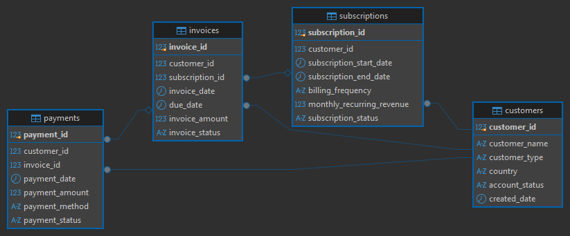

# SaaS Revenue Operations & Financial Analytics

### SQL Portfolio Project | PostgreSQL | DBeaver

## Project Overview

This project demonstrates the application of SQL to SaaS revenue operations, financial reporting, customer segmentation, and accounts receivable reconciliation.

Using a synthetic SaaS dataset, I developed a relational database and SQL queries to analyze recurring revenue, evaluate customer distribution, identify outstanding receivables, and investigate payment discrepancies.

The objective is to demonstrate how SQL can transform transactional billing and subscription data into actionable financial insights and exception reports.

**Technologies:** PostgreSQL, DBeaver, SQL, GitHub

**SQL techniques:** Joins, Common Table Expressions (CTEs), window functions, conditional aggregation, filtering, grouping, and financial calculations.

## Database Structure

The database consists of four related tables:

| Table | Purpose |
|---|---|
| customers | Customer profiles, segments, geographic information, and account status |
| subscriptions | Subscription dates, billing frequency, recurring revenue, and subscription status |
| invoices | Invoice amounts, due dates, and billing status |
| payments | Payment transactions, methods, amounts, and processing status |

All records are synthetically generated. No real customer or employer data is included in the intended dataset.

## 1. Customer Segmentation

Analyzed the distribution of 500 customer accounts across three market segments.

| Segment | Customers | Percentage |
|---|---:|---:|
| SMB | 267 | 53.4% |
| Mid-Market | 133 | 26.6% |
| Enterprise | 100 | 20.0% |

**Key findings:**
- 90% of customer accounts are marked Active.
- 10% are marked Cancelled.
- 75% of customers are located in the United States, with 25% in Canada.
- Cancelled accounts are concentrated in the Enterprise segment in the synthetic dataset.

The cancelled-account percentage is a status-based measure, not a historical churn rate.

## 2. Subscription Revenue Analysis

Calculated recurring revenue metrics using active subscription records.

| Metric | Result |
|---|---:|
| Active subscriptions | 630 |
| Monthly Recurring Revenue (MRR) | $338,500 |
| Annualized Recurring Revenue (ARR) | $4,062,000 |

### Revenue by Customer Segment

| Segment | Active subscriptions | MRR | Revenue share |
|---|---:|---:|---:|
| SMB | 374 | $120,500 | 35.60% |
| Mid-Market | 186 | $113,000 | 33.38% |
| Enterprise | 70 | $105,000 | 31.02% |

**Key finding:** Enterprise subscriptions contribute approximately 31% of MRR while representing only 11% of active subscriptions.

### Revenue by Billing Frequency

Annual subscriptions account for approximately 52% of normalized MRR, despite representing only one-third of active subscriptions.

MRR and ARR are annualized subscription metrics and do not represent recognized revenue or collected cash.

## 3. Payment Reconciliation & Accounts Receivable

Developed SQL queries to identify potential billing and payment discrepancies.

The analysis includes:

- Outstanding invoice balances after completed payment applications
- Payments without invoice references
- Failed and pending payment transactions
- Invoices marked Paid despite calculated outstanding balances
- Invoices with potential payment overapplication

### Selected Findings

| Exception category | Finding |
|---|---|
| Missing invoice references | Multiple transactions identified |
| Failed credit card payments | 133 transactions totaling $185,250 |
| Pending credit card payments | 48 transactions totaling $33,375 |
| Pending ACH payments | 60 transactions totaling $27,750 |
| Pending wire payments | 61 transactions totaling $27,875 |
| Paid invoices with outstanding balances | Multiple exceptions identified |
| Payment overapplication | No exceptions identified |

These results illustrate financial reconciliation controls. Exceptions require investigation and do not automatically indicate accounting errors.

## 4. SQL Skills Demonstrated

**Relational database design:** Created linked customer, subscription, invoice, and payment tables using primary and foreign keys.

**Data generation:** Built synthetic financial records to simulate SaaS billing and payment activity.

**Revenue analytics:** Calculated MRR, annualized ARR, and recurring revenue distribution.

**Customer analytics:** Used grouping, conditional aggregation, and window functions to evaluate customer segments.

**Financial reconciliation:** Used CTEs and joins to compare invoiced amounts against completed payments and flag discrepancies.

**Exception reporting:** Developed queries that identify potential operational and financial control issues.

## 5. Project Files

| File | Description |
|---|---|
| `01_create_tables.sql` | Creates the relational database tables |
| `02_generate_sample_data.sql` | Generates synthetic customer, subscription, invoice, and payment records |
| `03_customer_segmentation.sql` | Analyzes customer distribution and cancellation status |
| `04_subscription_revenue.sql` | Calculates recurring revenue and subscription metrics |
| `05_payment_reconciliation.sql` | Identifies payment discrepancies and AR exceptions |

## 6. Running the Project

1. Install PostgreSQL and connect using a SQL client such as DBeaver.
2. Create a database named `saas_revenue_analytics`.
3. Connect to the new database.
4. Execute `01_create_tables.sql`.
5. Execute `02_generate_sample_data.sql`.
6. Run the remaining analysis scripts to explore customer, revenue, and payment metrics.

The scripts should be executed in numerical order. Run data-generation scripts only once unless the database has been reset.

## 7. Limitations and Future Enhancements

This project uses synthetic data with simplified financial assumptions. Certain customer, subscription, and payment patterns reflect deterministic data-generation rules rather than actual business behaviour.

Future enhancements could include:

- Historical customer and revenue churn calculations
- Accounts receivable aging dashboards
- Payment-to-invoice matching automation
- Credit note and adjustment reconciliation
- Monthly revenue trend analysis
- Data quality and financial control checks

## Business Application

This project reflects practical analytical workflows used in SaaS finance, revenue operations, and finance systems environments.

It demonstrates how SQL can support recurring revenue reporting, accounts receivable management, transaction reconciliation, and operational decision-making while reducing reliance on manual spreadsheet analysis.
